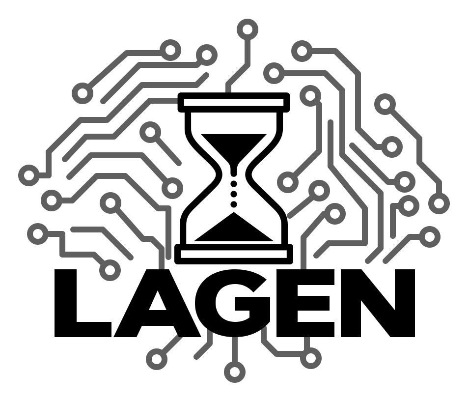

<p align="center">
  <a href="https://ragen-ai.github.io/lagen/"></a>
</p>

<h1 align="center">LAGEN: Are Vision-Language Agents Latency Aware?</h1>

<p align="center">
  Training agents for a world that keeps moving.
</p>

<p align="center">
  <a href="https://ragen-ai.github.io/lagen/"></a>
  <a href="https://ragen-ai.github.io/lagen/assets/paper.pdf"></a>
  <a href="https://huggingface.co/MLL-Lab/LAGEN-models"></a>
  <a href="https://huggingface.co/datasets/MLL-Lab/LAGEN-datasets"></a>
  <a href="https://huggingface.co/datasets/MLL-Lab/LAGEN-profiles"></a>
  <a href="#citation"></a>
</p>

## Overview

The world continues to change while an agent computes its next action.
**LAGEN** studies how deployment latency affects vision-language agents and
how training with latency prepares them for real-time interaction.

This repository, `latency-sensitive-bench`, provides the benchmark implementation:

- **Latency evaluation:** evaluate agents with fixed delays, variable delays,
  and replayed device profiles.
- **Deployment profiling:** measure inference and action latency on target
  hardware, fit latency profiles, and replay them in simulation.
- **Latency-aware training:** generate teacher demonstrations and train
  policies under controlled latency conditions.

Tasks include games, Gymnasium environments, MIKASA manipulation, and
HumanoidBench balance. VLA training and inference use the pinned
[`third_party/starVLA`](third_party/starVLA) source.

## Released Resources

| Resource | Contents |
| --- | --- |
| [Models](https://huggingface.co/MLL-Lab/LAGEN-models) | Teacher policies, VLA inference weights, model configurations, and task contracts |
| [Datasets](https://huggingface.co/datasets/MLL-Lab/LAGEN-datasets) | Teacher rollouts, training datasets, evaluation records, and experiment manifests |
| [Profiles](https://huggingface.co/datasets/MLL-Lab/LAGEN-profiles) | Measured latency traces, fitted deployment profiles, and calibration records |

Browse all three repositories in the
[LAGEN collection](https://huggingface.co/collections/MLL-Lab/lagen-6ac750f21139008b8114fff5).
Use the [artifact registry](docs/artifacts.md) to find experiment manifests,
exact checkpoint and dataset revisions, evaluation protocols, and publication
status.

## Getting Started

Use Linux x86_64 with an NVIDIA GPU. Install Git, Git LFS, and the required
driver and rendering libraries described in the
[setup guide](docs/QUICK_START.md).

Clone the repository with its vendored third-party sources:

```bash
git lfs install
git clone --filter=blob:none https://github.com/ZihanWang314/latency-sensitive-bench.git
cd latency-sensitive-bench
```

Install the shared benchmark environment and the model environment used by the
current StarVLA task pipeline:

```bash
bash install.sh --model openvla --tier dev
```

The installation target `openvla` is a historical environment name. The current
StarVLA variants `qwenoft`, `qwenpi_v3`, `qwengr00t`, and `wanoft` share
`starvla_rl_games_openvla`. Benchmark and data tools use the `latency`
environment.

Read the [run configuration contract](docs/configuration.md) for field ownership,
model sources and execution modes.

Complete the simulator-specific steps in the [setup guide](docs/QUICK_START.md).
Then follow the [standard pipeline](docs/standard_pipeline.md) to prepare data,
train, evaluate, and profile a policy. The task guides below specify the
required checkpoints, action interfaces, and evaluation settings.

## Documentation

| Guide | Use it to |
| --- | --- |
| [Installation](docs/QUICK_START.md) | Configure model environments, simulators, and dataset converters |
| [Standard pipeline](docs/standard_pipeline.md) | Prepare data, train a VLA, evaluate it, and profile deployment latency |
| [MIKASA Intercept Grab Fast](docs/mikasa/cookbook.md) | Reproduce manipulation workflows |
| [HumanoidBench Balance Simple](docs/humanoidbench/cookbook.md) | Reproduce balance workflows |
| [Demon Attack](docs/demon_attack.md) | Use the game-specific training and evaluation protocol |
| [Latency-aware PPO](docs/mikasa/latency_ppo.md) | Train MIKASA teachers with deployment profiles |
| [Latency execution semantics](docs/latency_execution_semantics_en.md) | Understand observation timing, action delays, and action application |
| [Deployment profiling](docs/profiling/cookbook.md) | Measure, publish, resolve, and replay device profiles |
| [Gymnasium adaptation](docs/gymnasium_adapter.md) · [Examples](docs/gym-adapt/gymnasium/README.md) | Adapt environments and follow worked examples |
| [Memory and temporal context](docs/memory.md) | Use visual history and policy memory |
| [Core infrastructure](docs/infra.md) | Locate runtime responsibilities and validation checks |
| [Artifact registry](docs/artifacts.md) | Select published inputs and inspect experiment evidence |

## Citation

If you use LAGEN in your research, please cite:

```bibtex
@misc{chafekar2026lagen,
  title={LAGEN: Are Vision-Language Agents Latency Aware?},
  author={Talha Chafekar and Zihan Wang and Zeju Li and Xinyuan Li and Qineng Wang and Jiajun Wu and Yuke Zhu and Yi Dong and Zhiding Yu and Ruohan Zhang and Manling Li},
  year={2026}
}
```


Use the same entrypoint for evaluation, collection, conversion and latency measurement:

```bash
python -m latency_bench eval --config eval.yaml
python -m latency_bench collect --config collect.yaml
python -m latency_bench convert --config convert.yaml
python -m latency_bench profile run --config profile.yaml
python -m latency_bench profile fit --run-dir /path/to/measurement
```

Task examples use flat filenames under `configs/examples/<task>/`. See
[collection](docs/rollout_collection.md), [configuration](docs/configuration.md),
and [profiling](docs/profiling/cookbook.md) for the input and artifact contracts.
